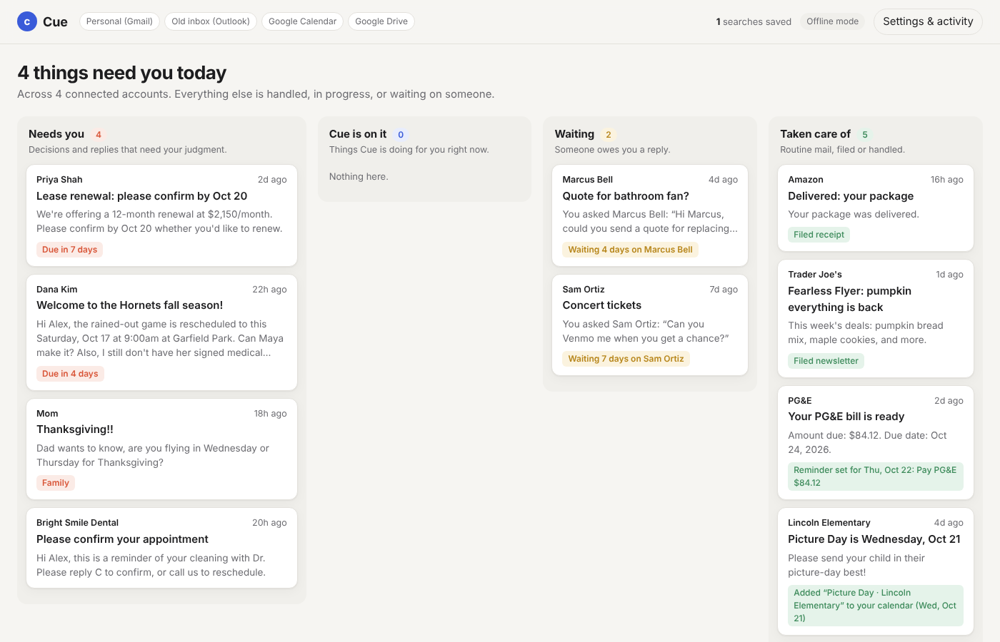
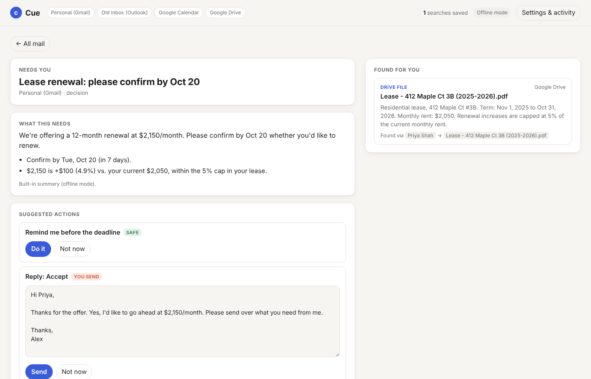

# Cue

**An AI-native inbox for everyday people.** Cue sits on top of the email accounts you already have (Gmail, Outlook, and others) and connects them with your calendar and files. Instead of a chronological list of messages, you get four lanes:

| Lane | What's in it |
|---|---|
| **Needs you** | Decisions and replies that need your judgment, most urgent first |
| **Cue is on it** | Things Cue is doing for you right now |
| **Waiting** | Someone owes you a reply |
| **Taken care of** | Newsletters and receipts filed, bills turned into reminders, school dates added to your calendar |

Open an email and Cue has already found the 2–4 things you'd otherwise go searching for: the signed form in your Drive, the birthday party that starts an hour after the soccer game, the flight confirmation that's sitting in your *other* inbox. Every suggestion comes with a ready-to-send action that you approve.





## Run it

Requires Node.js 22.18+ (it runs TypeScript directly, so there's no build step).

```bash
npm install
npm start            # http://localhost:3000
```

It starts in **offline mode** with a demo inbox for "Alex Rivera", a parent with a personal Gmail, an old Outlook address, a Google Calendar, and a Drive. Offline mode uses built-in templates for summaries and drafts. To have Claude write them:

```bash
ANTHROPIC_API_KEY=sk-ant-... npm start
```

| Variable | Default | Meaning |
|---|---|---|
| `PORT` | `3000` | HTTP port |
| `CUE_BRAIN` | `claude` if a key is set, else `heuristic` | Which brain writes summaries and drafts |
| `CUE_MODEL` | `claude-opus-5-5` | Claude model |
| `CUE_EFFORT` | `medium` | Claude effort level (`low` / `medium` / `high`) |
| `CUE_TZ` | `America/Los_Angeles` | User's time zone |
| `CUE_LIVE_CLOCK` | unset | Use the real time. By default the demo pins "now" to Tue Oct 13, 2026 so the data makes sense |
| `CUE_ACTION_DELAY_MS` | `2500` | Simulated execution time, so you can watch "Cue is on it" |

```bash
npm test             # 30 tests, no network needed
npm run typecheck
```

## Things to try in the demo

1. **Soccer email** (Needs you): Coach Dana asks two things in one message. Cue finds the *signed* medical form (ignoring the blank one), notices Leo's birthday party starts right after the game, and links a calendar invite from "Coach Dana &lt;dana.hornets@gmail.com&gt;" to Dana Kim at 85% confidence.
2. **Lease renewal**: Cue opens the lease PDF in Drive and does the math: *$2,150 is +$100 (4.9%) vs. your current $2,050, within the 5% cap in your lease.* It offers Accept and Decline drafts plus a reminder.
3. **Mom's Thanksgiving question**: the answer is in a United confirmation in the *Outlook* inbox. Cue finds it through the graph (Mom → Thanksgiving trip topic → flight email).
4. **Send a reply** and watch the thread move to *Cue is on it*, then to *Taken care of* (or to *Waiting* if your reply asks a question).
5. **Settings & activity**: turn autonomy rules on or off, see reminders, and read the log of everything Cue did and why.

## How it works

```
connectors ─▶ normalize ─▶ entity resolution ─▶ temporal knowledge graph
   ─▶ per thread: intent ─▶ graph traversal + rerank ─▶ signals
   ─▶ brain (words: Claude or templates) + planner (actions, with risk levels)
   ─▶ autonomy rules ─▶ executor ─▶ four lanes + audit log
```

[`docs/ARCHITECTURE.md`](docs/ARCHITECTURE.md) explains each step from first principles, with the math. [`docs/PRODUCT.md`](docs/PRODUCT.md) covers the product decisions, including how this differs from the original concept brief (which targeted knowledge workers).

| Path | What it does |
|---|---|
| `src/ingest/` | Connectors and normalizers that turn Gmail/Outlook/Calendar/Drive objects into one shared model. Demo fixtures live here |
| `src/resolve/entities.ts` | Works out that two identities are the same person: exact email first, fuzzy name + context second |
| `src/graph/` | In-memory temporal knowledge graph, graph builder, fact extraction with validity windows |
| `src/intent/classify.ts` | Rule-based intent classification and date extraction |
| `src/retrieve/` | Intent-aware graph traversal, then TF-IDF reranking (a stand-in for embeddings) |
| `src/agent/` | Brains (heuristic + Claude), the action planner, and autonomy rules |
| `src/triage/buckets.ts` | Lane assignment and priority |
| `src/engine.ts` | Wires the pipeline together and holds state, actions, and the audit log |
| `src/server.ts` | JSON API and static file server |
| `web/` | The UI: plain HTML, CSS, and JS |

## Status

This is a working prototype on demo data. What's real and what's stubbed:

- **Real:** the whole pipeline (normalization, entity resolution, the temporal graph, traversal, reranking, fact extraction, triage, planning, autonomy, execution, undo, audit), the Claude integration, and the UI.
- **Stubbed:** connectors replay fixtures instead of calling Gmail, Outlook, Calendar, and Drive. Executed actions change in-memory state instead of writing back to those services. State lives in memory, so restarting resets it.

The next steps are in [`docs/PRODUCT.md`](docs/PRODUCT.md#roadmap).
